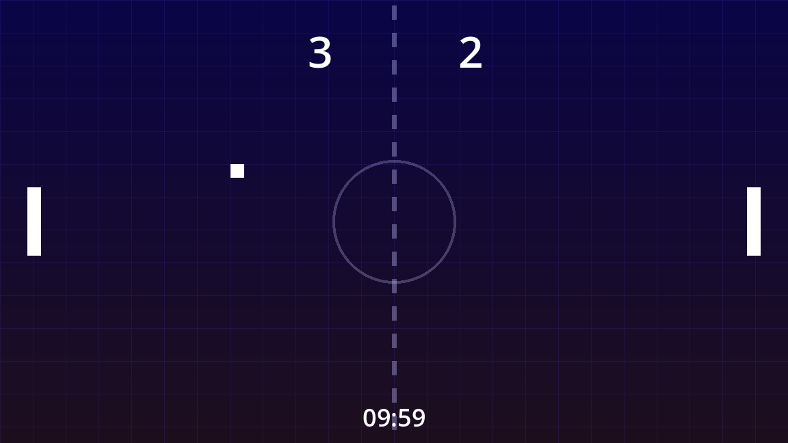
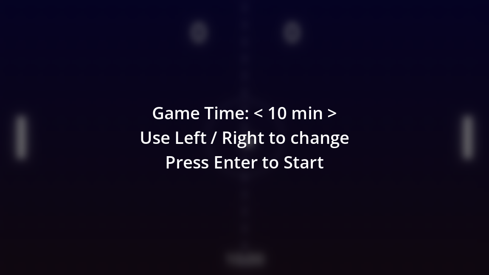
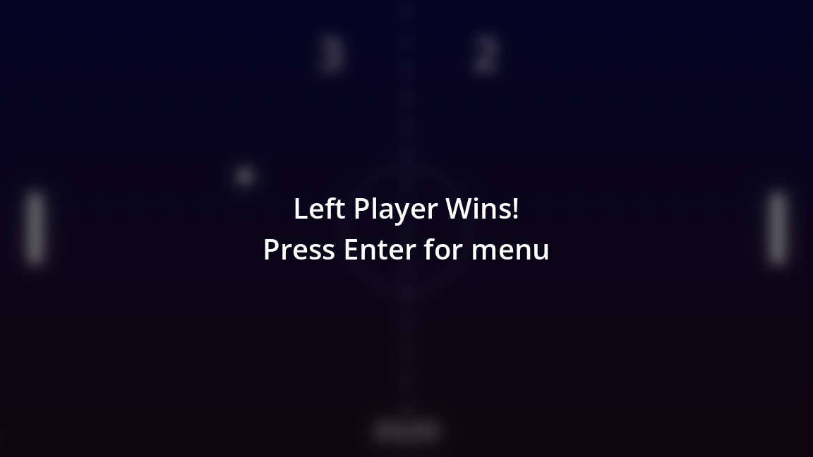

# Pong Game (Godot 4)

A two-player local Pong game built with Godot 4.7 and GDScript. Players pick a match length, play until the timer runs out, and the player with the higher score wins.



## Screenshots

| Menu | Gameplay | Winner |
|------|----------|--------|
|  |  |  |

## Features

- Two players on one keyboard
- The ball's angle depends on where it hits the paddle
- The ball speeds up 5% on every paddle hit, up to a maximum speed
- Sound effects for paddle hits, wall hits and scoring
- Custom background image
- Match timer you can set from 1 to 20 minutes
- Winner screen showing the left player, the right player or a draw
- Blurred, darkened menu screen made with a shader

## Controls

| Action | Key |
|--------|-----|
| Left player up / down | `W` / `S` |
| Right player up / down | `↑` / `↓` |
| Change match time (menu) | `←` / `→` |
| Start game / back to menu | `Enter` |

## How to Run

1. Install [Godot 4](https://godotengine.org) (Standard version; tested with 4.7.2).
2. In the Project Manager, click **Import** and select `project.godot` from this folder.
3. Press **F5** to run.

## Project Structure

```
pong-game/
├── main.tscn          # Main scene (paddles, ball, walls, goals, UI)
├── main.gd            # Score, timer, menu and game states
├── main.gdshader      # Blur shader for the menu overlay
├── paddle.tscn        # Reusable paddle scene
├── scripts/
│   ├── ball.gd        # Ball movement, bounce and sounds
│   └── paddle.gd      # Paddle movement
├── assets/            # Background image and sound effects
└── docs/
    └── images/        # Screenshots
```

## Game States

| State | What happens | Next |
|-------|--------------|------|
| `menu` | Choose the match time; the ball is stopped | `Enter` → `playing` |
| `playing` | The game runs and the timer counts down | Time is up → `over` |
| `over` | The winner is shown | `Enter` → `menu` |
